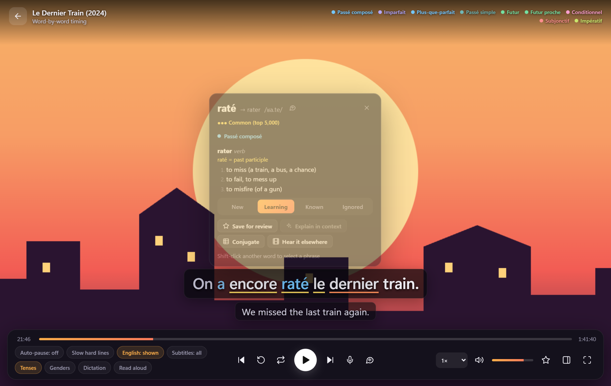
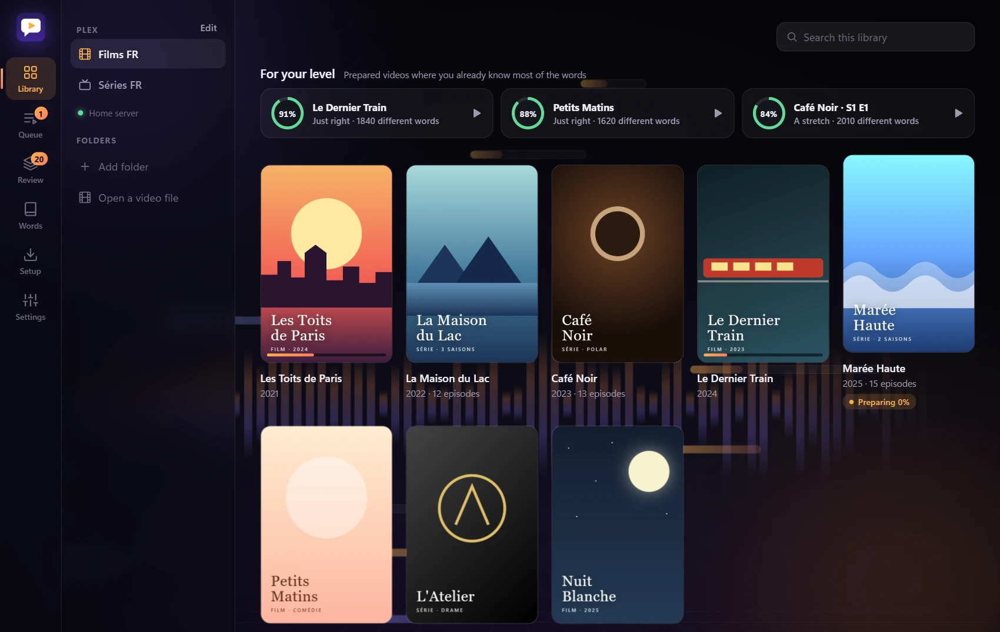
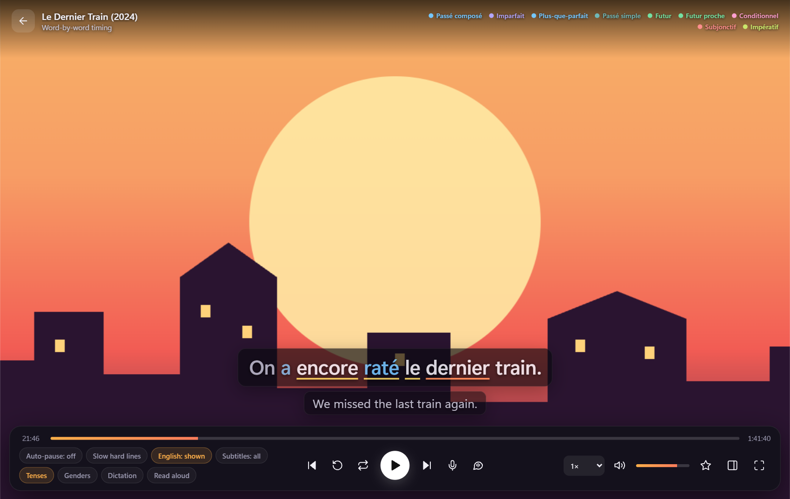
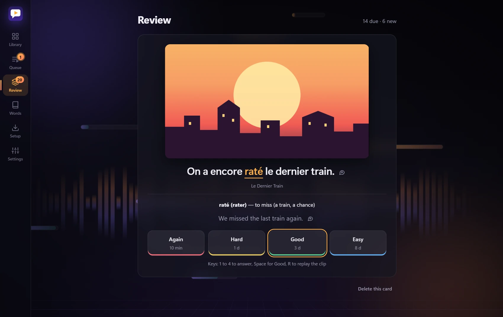
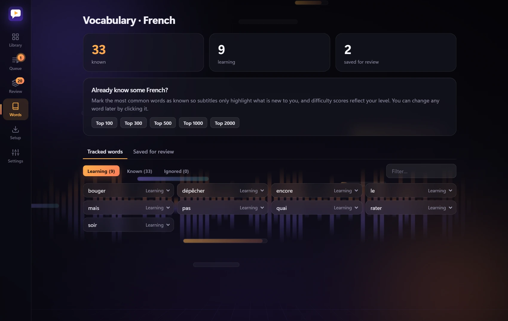

# LingoReel

Learn a language by watching the movies and series you already own.

LingoReel is a Windows desktop player that shows subtitles in the language you are
learning and in English at the same time, lights up each word as it is spoken, and
lets you click any word for its meaning. It plays from your Plex library or from
plain folders of video files.



## How it works

| | |
|---|---|
|  |  |
| **1. Pick something to watch** from Plex or a folder. "For your level" suggests prepared videos where you already know most of the words. | **2. Watch with two subtitle lines.** Each word lights up as it is spoken; click one for its meaning and grammar (as in the picture at the top), then save it for review. |
|  |  |
| **3. Review saved words** as cards with the scene they came from. | **4. Track your vocabulary.** Known words stop being highlighted, so subtitles show what is new to you. |

The titles, posters and subtitles in these screenshots are made up.

## Install

Download `LingoReel_x.y.z_x64-setup.exe` from the
[latest release](https://github.com/JustSad42/LingoReel/releases/latest) and run it.
No administrator rights are needed. On first start a short tour explains the app, and the
Setup screen downloads the player engine, dictionary and (optionally) speech recognition
and a local language model. Choose Light setup for a smaller first download. After that
the app works offline, updates itself and shows what changed.

## What it does

- **Two subtitle lines** – target language and English together; English can be shown, blurred until asked for, or hidden.
- **Word-by-word timing** – Whisper listens to each video once on your GPU, so every word highlights when spoken and badly timed subtitle files are corrected. Videos with no subtitles get them written from the audio.
- **Click-to-look-up** – offline dictionary (Wiktionary) with the base form, grammar of the form you clicked, gender, pronunciation and how common the word is.
- **Line navigation** – replay, previous and next line, pause on hover, slow down lines with unknown words. Auto-pause after every line, or only after lines with a word you are learning. Q jumps back to the start of the line and shows its English even when English is hidden.
- **Loop** – loop the current line, or any stretch you mark, and play it slower.
- **Set phrases** – expressions such as « en train de » or « sin embargo » are dotted underneath; a word's popup gives the meaning of the whole phrase.
- **Conjugation tables** – every tense of a verb, from its popup, with the form you heard highlighted.
- **Grammar notes** – what each tense is for and how it is built, with lines from your own videos that use it.
- **Word families** – related words built on the same root, in the popup.
- **Gender colours** – nouns tinted blue (masculine), pink (feminine) or green (neuter); can be switched off.
- **Subtitle style** – move the subtitles up or down, change the font and the box behind them, or outline the letters.
- **Known-word tracking** – words are underlined by how well you know them; every video gets a "percent known" difficulty score and a list of words to study first.
- **Review** – save words or whole lines; each keeps a short clip of the scene and comes back on a spaced-repetition schedule (FSRS). Cards can be classic, fill in the missing word, or listen first and read after.
- **For your level** – the Library suggests prepared videos where you already know most of the words.
- **Phrase explanations** – a small model running on your own PC explains idioms and grammar in context. Nothing is sent to a cloud service. A larger optional model (Gemma 3 12B) gives better translations and explanations on graphics cards with about 9 GB free.
- **Shadowing** – hear a line, record yourself, and see which words were recognised.
- **Subtitle modes** – show every word, dim the words you know so new ones stand out, or reveal the line only after it has been spoken.
- **Dictation** – hear a line with no subtitles, type what you heard, and see which words you got.
- **Tense colours** – verbs are tinted by tense (passé composé, imparfait, futur, conditionnel, subjonctif and more); can be switched off.
- **Easy lines** – finds every line with exactly one word you do not know and adds them to review in one click.
- **Hear it elsewhere** – plays other scenes from your prepared videos where the same word is spoken.
- **English films too** – for a video whose audio is English (or any language other than the one you study), you read its French subtitles with the English line underneath, each line timed to the speech. With no French subtitles, the local model translates the English ones.
- **Real subtitles through Plex** – when a video has no subtitles in the language you study, LingoReel asks your Plex server to download some (OpenSubtitles) before falling back to a translation. Spanish prefers subtitles from Spain.
- **Beginner translations** – when the local model translates, choose natural subtitles or simple ones (short sentences, common words). Spanish translations use Spain's Spanish.
- **Mixed subtitles** – the English line with the words you are learning or know shown in the studied language; click one to look it up.
- **Read aloud** – an offline voice (Piper) reads words, lines and review cards aloud, or every line in turn. Voices for French, Spanish (Spain), German, Italian and Portuguese, plus an English voice that reads mixed subtitles and review-card translations.
- **Keep ready** – mark a series and its next 3 unwatched episodes are always prepared.
- **Background queue** – queue movies, episodes, seasons or whole series from the Library and they are prepared one after another while you do something else. Pausing frees the graphics card; the queue carries on after a restart.
- **Next episode** – the following episode is prepared in the background while you watch, then offered when the credits start.
- **Skip intro and credits** – uses the intro and credits markers from your Plex server when it has them.

Graphics cards: NVIDIA, AMD Radeon RX and Intel Arc cards all run speech recognition on the
card. PCs without one use a smaller model on the processor.

Languages: French, Spanish (Castilian preferred when a video has both Spain and Latin America
tracks), German, Italian, Portuguese and Japanese. Japanese shows romaji or hiragana above each
word. Each language has its own dictionary, vocabulary and review cards.

Other conveniences: choose which Plex libraries to show, switch audio language (remembered per
series), volume control, a cached library that opens instantly, and remembered window size,
speed, volume and last library.

## Keys while watching

| Key | Action |
| --- | --- |
| Space | Play / pause |
| A or ← | Previous line |
| S or ↓ | Replay line |
| D or → | Next line |
| E or ↑ | Reveal the English line |
| Q | Back to the start of the line, with its English |
| B | Loop the line (Shift+B: mark start, then end) |
| P | Auto-pause: every line, learning words, off |
| C | Gender colours |
| Shift+↑ / ↓ | Move the subtitles up / down |
| T | Transcript panel |
| W | Save the line for review |
| R | Shadowing |
| - and = | Volume (also the mouse wheel) |
| V | Mute |
| X | Dictation |
| M | Subtitle mode |
| G | Tense colours |
| I | Skip the intro |
| N | Next episode |
| H | Hear the line read aloud |
| L | Read every line aloud |
| [ and ] | Slower / faster |
| F | Fullscreen |
| Esc | Close / back |

## Building from source

Requires Node 20+ and Rust.

```
npm install
npm run dev:app        # run with a separate data folder, safe next to an installed copy
npm run tauri build    # installer in src-tauri/target/release/bundle/nsis
```

To publish a new version: `.\release.ps1 0.5.0`. GitHub Actions builds and signs the
installer; installed copies update on their next launch.

## Credits

Dictionary data from [Wiktionary](https://www.wiktionary.org/) via
[kaikki.org](https://kaikki.org/) and word frequencies from
[FrequencyWords](https://github.com/hermitdave/FrequencyWords), both CC BY-SA.
Playback by [mpv](https://mpv.io/), media handling by [FFmpeg](https://ffmpeg.org/),
speech recognition by [whisper.cpp](https://github.com/ggml-org/whisper.cpp), local
model serving by [llama.cpp](https://github.com/ggml-org/llama.cpp).
